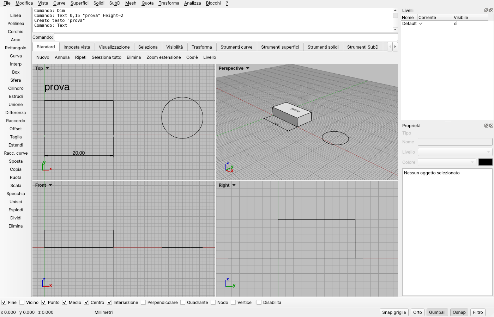

# Kurva3D

Applicazione CAD indipendente, per uso personale, che prende come riferimento
**Rhinoceros 8 per Windows 64 bit** e punta alla piena compatibilità con i
file `.3dm` di Rhino 8. Nessun codice proprietario di McNeel viene copiato:
il comportamento dei comandi si riproduce studiando Rhino 8, e il formato
`.3dm` si legge e scrive con **openNURBS**, la libreria open source che McNeel
pubblica proprio a questo scopo.

## Regole del progetto

1. Riferimento unico: Rhino 8 per Windows (interfaccia, comandi, scorciatoie,
   console comandi, viewport).
2. Riprodurre il comportamento, mai copiare codice proprietario.
3. Compatibilità massima con i `.3dm` di Rhino 8, verificata con test incrociati.
4. Matrice di compatibilità per categoria: [docs/COMPATIBILITA.md](docs/COMPATIBILITA.md).
5. Niente è "compatibile" finché non è verificato in Rhino 8.
6. Elenco delle differenze: [docs/DIFFERENZE.md](docs/DIFFERENZE.md).
   Inventario dei comandi di Rhino 8 e loro stato: [docs/COMANDI.md](docs/COMANDI.md).
7. Niente funzioni di Rhino 9 prima di aver completato Rhino 8 (per questo
   openNURBS è fissato a un tag **8.x**: il ramo principale scrive già file v9).

## Stack tecnico

| Parte | Scelta | Perché |
|---|---|---|
| Linguaggio | C++20 | Lo stesso di openNURBS: nessuno strato di conversione, prestazioni da CAD |
| Build | CMake ≥ 3.24 | Funziona con Visual Studio 2022 su Windows e con GCC/Clang |
| Formato .3dm | openNURBS `v8.35.26251.13001` | Libreria ufficiale e open source di McNeel; scrive file Rhino 8 |
| Interfaccia | Qt 6 (`kurva3d`) | Finestre agganciabili, barre strumenti e riga di comando come Rhino |
| Viewport | OpenGL 2.1 (pipeline fissa) | Quattro viste (Top, Perspective, Front, Right) come Rhino 8; funziona su ogni scheda video |
| Geometria | openNURBS + OpenCASCADE 7.x | openNURBS valuta NURBS/B-rep/SubD; OpenCASCADE fa booleane, raccordi, offset, loft, sweep, split, mesh |

Dettagli e alternative: [docs/STACK.md](docs/STACK.md).

## Struttura

```
src/core/            nucleo: documento .3dm, riepilogo per categoria, confronto modelli
src/commands/        motore dei comandi (sintassi delle macro di Rhino) e comandi
src/kernel/          ponte openNURBS <-> OpenCASCADE e comandi che ne hanno bisogno
src/ui/              finestra in stile Rhino 8 (Qt): riga di comando, 4 viste, pannelli
tools/cad-console    riga di comando in stile Rhino: crea e modifica modelli
tools/3dm-info       stampa il contenuto di un .3dm per categoria
tools/3dm-roundtrip  legge → salva come Rhino 8 → rilegge → confronta
tests/rhino8_files/  file salvati da Rhino 8 per i test incrociati
docs/                matrice di compatibilità, differenze, stack
```

## Compilare su Windows

Servono Visual Studio 2022 (carico di lavoro "Sviluppo di applicazioni desktop
con C++", che include CMake) e Git. Da "Developer PowerShell for VS 2022":

```powershell
cd G:\github\rhinoceros
cmake -S . -B build -G "Visual Studio 17 2022" -A x64
cmake --build build --config Release
ctest --test-dir build -C Release
```

La prima configurazione scarica openNURBS da GitHub (circa 200 MB).
Così si compilano il nucleo, i comandi base e i test. Per la finestra grafica
e per i comandi che usano il motore geometrico servono anche **Qt 6** e
**OpenCASCADE**; il modo più semplice è vcpkg (una volta sola, richiede
1-2 ore di compilazione):

```powershell
git clone https://github.com/microsoft/vcpkg C:\vcpkg
C:\vcpkg\bootstrap-vcpkg.bat
C:\vcpkg\vcpkg install qtbase:x64-windows opencascade:x64-windows
cd G:\github\rhinoceros
cmake -S . -B build -G "Visual Studio 17 2022" -A x64 -DCMAKE_TOOLCHAIN_FILE=C:\vcpkg\scripts\buildsystems\vcpkg.cmake
cmake --build build --config Release
build\Release\kurva3d.exe
```

In alternativa: Qt 6 dall'installer ufficiale (componente MSVC 2022 64-bit)
e OpenCASCADE 7.x dall'installer del sito, passando a CMake
`-DCMAKE_PREFIX_PATH="C:\Qt\6.x\msvc2022_64;C:\OpenCASCADE-7.x\occt"`.
Se CMake non li trova lo dice nell'output e compila il resto.
**Nota:** la build Windows di `kurva3d` e del kernel non è ancora stata
provata (vedi D-023); la versione Linux è compilata e testata.

## Compilare su macOS

```sh
brew install qt opencascade ninja cmake
cmake -S . -B build -G Ninja -DCMAKE_BUILD_TYPE=Release \
  -DCMAKE_PREFIX_PATH="$(brew --prefix qt);$(brew --prefix opencascade)"
cmake --build build
open build/kurva3d.app
```

La CI (`.github/workflows/build.yml`) crea `Kurva3D.app` autonoma con
`macdeployqt`, la firma e la notarizza se nei Secrets del repository ci sono
`MACOS_CERTIFICATE`, `MACOS_CERTIFICATE_PASSWORD`, `APPLE_ID`,
`APPLE_APP_PASSWORD` e `APPLE_TEAM_ID`, e la mette in un dmg.

## La finestra (kurva3d)



Disposizione come Rhino 8: menu in alto, cronologia e riga `Comando:`, barra
dei comandi a sinistra, quattro viste (Top, Perspective, Front, Right),
pannelli Livelli e Proprietà a destra, barra di stato con coordinate e
interruttori Snap griglia, Orto, Osnap.

- Scrivi il nome del comando (anche senza cliccare sulla riga), poi Invio o
  Spazio; Invio a vuoto ripete l'ultimo comando.
- Clicca i punti nelle viste, oppure scrivi le coordinate; Invio termina,
  Esc annulla.
- Se un comando ha bisogno di oggetti e non ce ne sono di selezionati, li
  chiede: cliccali e premi Invio (es. Trim: clicca gli oggetti di taglio,
  Invio, poi clicca la parte da eliminare).
- Clic su un oggetto per selezionarlo; Shift aggiunge, Ctrl toglie; trascinando
  da sinistra a destra selezioni a finestra, da destra a sinistra a intersezione.
- Tasto destro trascinato: ruota (Perspective) o sposta la vista; Shift+destro
  sposta; Ctrl+destro o rotella: zoom. Doppio clic sul titolo ingrandisce la vista.
- `kurva3d file.3dm` apre un file; `--script comandi.txt` esegue uno script.
- **Vista > Tema**: Automatico (segue il chiaro/scuro di Windows), Chiaro o Scuro.

## Scambio di file

**File > Apri** e **File > Importa** leggono .3dm, STEP, IGES, STL, OBJ e DXF;
**File > Esporta selezione** scrive gli stessi formati (il formato si sceglie
dall'estensione). Da riga di comando: `_Import "pezzo.stp"`,
`_SelAll _Export "pezzo.stl"` (aggiungi `Ascii` per l'STL di testo).
**File > Salva vista come immagine** (comando ViewCaptureToFile, opzioni
Width=, Height=, DrawGrid=No) salva la vista attiva in PNG o JPG.

## Viste, piani di costruzione e sezioni

Menu **Vista**: piano di costruzione della vista attiva (`CPlane`), viste e piani con nome (`NamedView`, `NamedCPlane`, salvati nel .3dm come in Rhino), piani di sezione (`ClippingPlane` disegna un rettangolo sul piano di costruzione e taglia la vista attiva; `EnableClippingPlane`/`DisableClippingPlane` con `All` per tutte le viste) e istantanee (`Snapshots`: vista, livelli e stato degli oggetti). Le viste delle finestre vengono salvate nel file e ritrovate alla riapertura.

## Tavole, stampa e PDF

Le schede sotto le viste (**Modello**, **Pagina 1**, ...) mostrano le tavole come in Rhino 8; il **+** crea una tavola (formato A4-A0, orientamento, 1 o 4 dettagli). Nella tavola si disegna in millimetri sul foglio (cornici, testi); `Detail Add` aggiunge un dettaglio, `Detail Scale 1:50` lo mette in scala. **File > Stampa...** usa la stampante di sistema, **File > Esporta PDF...** scrive un PDF vettoriale (le viste ombreggiate sono immagini). Da riga di comando: `Print Destination=PDF File="tavole.pdf" View=All`.

## Rendering

Modalita' di visualizzazione **Renderizzato** (colori dei materiali, luci del modello, ombre sul piano di terra) e **Raytraced** (immagine che si affina da sola, calcolata in un thread mentre si lavora), dal menu del titolo della vista o con `SetDisplayMode`. **Render > Rendering** apre la finestra di rendering con il salvataggio in PNG/JPG; da script: `Render Width=1920 Height=1080 Samples=256 File="render.png"`. Luci: `PointLight`, `DirectionalLight`, `SpotLight`, `RectangularLight`; `Sun On Azimuth=135 Altitude=40`, `Skylight`, `GroundPlane`. `SetMaterial Color=200,40,40 Gloss=0.8` assegna un materiale semplice (vetro: `Transparency=0.95 IOR=1.5`).

## Texture

Pannello **Texture** (a destra, o menu **Render > Pannello Texture**): mostra le
immagini di una cartella (predefinita `Documenti\Kurva3D\Texture`, si cambia
con **Cartella…**; **Aggiungi…** copia immagini nella cartella). Doppio clic o
**Applica** mette la texture sugli oggetti selezionati; si puo' anche trascinare
l'anteprima (o un'immagine da Esplora file) su un oggetto in una vista. Mappatura
(Automatica, Superficie, Box, Piana, Cilindrica, Sferica) e Ripetizioni si
scelgono nel pannello. L'immagine viene salvata dentro il file .3dm, quindi il
file si apre con le texture anche su un altro computer. Le texture si vedono
nella modalita' Ombreggiato.

## Assistente AI

Menu **AI > Assistente AI**: descrivi a parole cosa disegnare (per esempio
"un tavolo 120x80 alto 75 con quattro gambe"). Un modello linguistico che gira
sul tuo computer (llama.cpp, nessun dato inviato in rete) scrive uno script di
comandi Kurva3D; il programma lo prova su una copia del documento, lo fa
correggere al modello se non funziona e lo mostra. **Anteprima** crea gli
oggetti, **Conferma** li tiene (un solo Annulla li toglie), **Scarta** li
rimuove. Lo script si puo' modificare a mano prima dell'anteprima.

Al primo uso **Modello...** controlla memoria e scheda video e propone il
modello adatto (Qwen3 da 1,7B a 32B, licenza Apache 2.0); il download da
Hugging Face mostra l'avanzamento e verifica licenza e SHA-256. I modelli
stanno in `%LOCALAPPDATA%\Kurva3D\models`. llama.cpp e' nella cartella
`llama` accanto a `kurva3d.exe` (usa la scheda video con Vulkan se c'e').

## Modellare dalla console

`cad-console` accetta i comandi con la stessa sintassi delle macro di Rhino 8.
Scrivi `?` per l'elenco dei comandi, `esci` per uscire.

```text
Comando: _Box 0,0,0 10,20 30
Comando: _Circle 50,0 8
Comando: _SelLast _ExtrudeCrv _Solid=_Yes 25
Comando: _SelAll _ArrayPolar 0,0 6
Comando: _SaveAs "C:\modelli\prova.3dm"
```

Oppure da uno script: `cad-console script.txt -o risultato.3dm`.
Punti: `x,y` o `x,y,z`; relativi `r5,0` o `@5,0`; polari `10<45`.

## Usare gli strumenti

```powershell
build\Release\3dm-info.exe C:\percorso\modello.3dm
build\Release\3dm-roundtrip.exe C:\percorso\modello.3dm C:\percorso\copia.3dm
```

`3dm-roundtrip` esce con codice 0 solo se la copia, riletta, è uguale
all'originale per tutto ciò che il confronto controlla (vedi
`src/core/ModelCompare.h`).

## Licenza e vendita

Il codice di Kurva3D è "tutti i diritti riservati" (`LICENSE.txt`); l'uso del programma è regolato da `EULA.txt`. Cosa serve per venderlo è in [docs/VENDITA.md](docs/VENDITA.md).

## Licenze di terze parti

Kurva3D usa openNURBS (licenza permissiva di McNeel), Open CASCADE Technology (LGPL 2.1 con eccezione) e Qt 6 (LGPL 3). Elenco e testi completi in [THIRD_PARTY_NOTICES.txt](THIRD_PARTY_NOTICES.txt) e nella cartella `licenses`, copiati anche nello zip di ogni versione. Rhinoceros e Rhino sono marchi di Robert McNeel & Associates; Kurva3D non è affiliato a McNeel.
